# ShelfSense - RFID-Powered Smart Library Guidance System

[](https://platformio.org/)
[](https://www.espressif.com/)
[](https://www.arduino.cc/)
[](https://firebase.google.com/)
[](https://www.freertos.org/)
[](https://www.nxp.com/)
[](https://en.wikipedia.org/wiki/Liquid-crystal_display)
[](LICENSE)

**ShelfSense** is an enterprise-grade, physical library navigation and patron guidance kiosk built on the ESP32. Featuring welcome branding for **ABPS Nandyal**, it pairs dual-state RFID verification with an **offline-first local cache** and **silent background Google Cloud Firestore synchronization**. Patrons authenticate with their student ID card and scan cataloged books to receive immediate visual, acoustic, and animated shelf/rack guidance without encountering network latency.

---

## Table of Contents

- [Architectural Highlights](#architectural-highlights)
- [System Architecture & Workflow](#system-architecture--workflow)
- [Core Features](#core-features)
- [Interactive Serial Commands](#interactive-serial-commands-115200-baud)
- [Hardware & Pinout Reference](#hardware--pinout-reference)
  - [1. RC522 RFID Reader (SPI / VSPI)](#1-rc522-rfid-reader-spi--vspi)
  - [2. 16x2 Character LCD (I2C Backpack)](#2-16x2-character-lcd-i2c-backpack)
  - [3. Status Indicators (Buzzer & Dual LEDs)](#3-status-indicators-buzzer--dual-leds)
  - [ESP32 Hardware Safety Guidelines](#esp32-hardware-safety-guidelines)
- [Operational Behavior & Guidance Choreography](#operational-behavior--guidance-choreography)
- [Cloud & Database Configuration](#cloud--database-configuration)
  - [Firestore Collections](#firestore-collections)
  - [Offline-First NVS Flash Caching](#offline-first-nvs-flash-caching)
  - [Registered Library Books Catalog](#registered-library-books-catalog)
- [Build, Flash & Memory Configuration](#build-flash--memory-configuration)
- [Serial Monitor Diagnostic Reference](#serial-monitor-diagnostic-reference)
- [Troubleshooting](#troubleshooting)
- [Project Structure](#project-structure)
- [License](#license)

---

## Architectural Highlights

- **Dual-Core FreeRTOS Partitioning**:
  - **Core 1 (Real-Time Hardware Engine)**: Dedicated entirely to SPI RFID polling, 16x2 I2C LCD animations, buzzer tones, dual-LED feedback, and serial CLI commands. Scanning evaluates with **instant 0ms zero network latency**.
  - **Core 0 (Background Cloud Worker)**: Runs an asynchronous worker task managing Wi-Fi connectivity, NTP time synchronization, Firebase email/password authentication, periodic 20-second roster diff checks, and non-blocking transaction dispatching.
- **Strict Separation of Concerns (Zero Cloud on LCD)**:
  - The 16x2 LCD is strictly reserved for physical user guidance. Wi-Fi connection states, NTP handshakes, and cloud sync payloads are isolated entirely to the USB Serial Monitor (115200 baud).
- **Offline-First Roster & Book Catalog Caching**:
  - The student roster and library book catalog are synchronized from Google Cloud Firestore (`student_names` and `book_names` collections) and cached in ESP32 Non-Volatile Storage (NVS / Preferences under `"students"` and `"books"` namespaces).
  - Validates card and book active status locally. Suspended cards or unavailable books (`active: false`) are immediately handled on-device.
  - Automatically compares local ROM against Firestore every 20 seconds. If differences are detected in student roster or book catalog, it updates ROM and executes a graceful 3-second countdown restart (`"Data Updated! / Restarting in 3.."`).
- **Persistent Offline Log Buffering**:
  - Transactions are dispatched to a FreeRTOS background queue. If Wi-Fi is lost or Firestore is temporarily unreachable, up to 20 transaction events are buffered in persistent ROM (`"off_logs"` namespace) and automatically flushed upon reconnection.
- **Accurate NTP Timestamping**:
  - System time synchronized with Indian Standard Time (IST: UTC+5:30 / 19800 seconds). Documents in Firestore use clean formatted IDs (`YYYY-MM-DD_HHMMSS`) combining patron login and book processing into a unified audit trail.
- **Zero Dynamic Allocation (24/7 Production Stability)**:
  - Fixed stack buffers (`char[]`), `const char*` pointers, and `F(...)` flash strings eliminate heap fragmentation and memory leaks during continuous 24/7 public kiosk operation.

---

## System Architecture & Workflow

```mermaid
stateDiagram-v2
    [*] --> BootDiagnostics: Power ON / Reset
    BootDiagnostics --> WaitingForStudent: Splash (1.8s) -> Steady LCD: "Please Tap Your Student ID Card"

    state "Core 0 (Background)" as Core0 {
        [*] --> WiFiConnect: Wi-Fi STA
        WiFiConnect --> NTPSync: Sync Clock (IST GMT+5:30)
        NTPSync --> FirebaseAuth: Email/Password Token
        FirebaseAuth --> InitialRosterSync: Fetch Firestore 'student_names' -> Cache to ROM
        InitialRosterSync --> BackgroundLoop: 20s Diff Check & Offline Log Flush
    }

    state "State 0: WAITING_FOR_STUDENT (Core 1)" as WaitingForStudent {
        [*] --> DetectTag0: Card Presented
        DetectTag0 --> CheckRestMode: Check if System in REST Mode
        CheckRestMode --> RestModeAlert: ROM Empty / REST Mode -> Alert LCD
        CheckRestMode --> VerifyROM: Verify against Local ROM Cache
        VerifyROM --> ActiveStudent: Active Student (active=true)
        VerifyROM --> SuspendedStudent: Suspended Student (active=false)
        VerifyROM --> BookEarlyWarn: Scanned Book Tag Early
        VerifyROM --> UnrecognizedAlarm0: Unregistered Tag
    }

    RestModeAlert --> WaitingForStudent: LCD: "ROM Empty / System Rest Mode" (2 Beeps + Red LED)
    SuspendedStudent --> WaitingForStudent: LCD: "Card Suspended / Contact Admin" (2 Beeps + Red LED)
    BookEarlyWarn --> WaitingForStudent: LCD: "Please Tap Your / Student ID First" (2 Warning Beeps + Red LED)
    UnrecognizedAlarm0 --> WaitingForStudent: LCD: "Unrecognized ID / Access Denied!" (2s Siren + Red Strobe + Log SECURITY_ALERT)

    ActiveStudent --> WaitingForBook: Beep + Green Pulse | LCD: "Hi <Name>" (Scroll) / "Tap Book Tag..." (18s Timer Started)

    state "State 1: WAITING_FOR_BOOK (Core 1)" as WaitingForBook {
        [*] --> DetectTag1: Card Presented or Inactivity
        DetectTag1 --> BookFound: Valid Book Tag
        DetectTag1 --> StudentAgainWarn: Scanned Student Card Again (Timer Renewed +18s)
        DetectTag1 --> UnrecognizedAlarm1: Unregistered Tag (Timer Renewed +18s)
        DetectTag1 --> SessionTimeout: Inactivity >= 18s
    }

    StudentAgainWarn --> WaitingForBook: LCD: "Please Tap Book / Tag (Not ID)" (Session Maintained)
    UnrecognizedAlarm1 --> WaitingForBook: LCD: "Unrecognized ID / Unknown Book Tag" (2s Siren, Session Maintained)
    SessionTimeout --> WaitingForStudent: LCD: "Session Expired / Please Try Again" (2 Beeps + Red LED + Log SESSION_TIMEOUT)

    BookFound --> AnimatedGuidance: Beep + Green Pulse | Queue BOOK_PROCESSED to Firestore

    state "Animated Shelf Guidance & Return Sequence" as AnimatedGuidance {
        [*] --> TitleScroll: Adaptive Scroll Title (Line 1) + Green LED Rhythm
        TitleScroll --> RevealShelf: 4 chars before end: Reveal "Shelf:X  Rack:Y" (Line 2) + Audio Chime
        RevealShelf --> HoldPhase1: Hold view 4s with Solid Green LED ON
        HoldPhase1 --> HoldPhase2: Move Shelf & Rack to Line 1; Line 2 scrolls "Please place it in given shelf" (4s)
        HoldPhase2 --> WarningPhase: LCD: "Session Ending.." + 3 Warning Beeps & Green LED Flashes (3s)
        WarningPhase --> PostRoundTrigger: Green LED OFF
    }

    PostRoundTrigger --> WaitingForStudent: Auto-Reset & Trigger Immediate Background Cloud Sync
```



---

## Core Features

- **Instant Local Authentication with Cloud Synchronization**:
  - Evaluates RFID cards directly against local NVS flash with **0ms latency**.
  - Background task monitors Firestore for patron modifications, additions, or suspensions.
- **Suspended Student Enforcement**:
  - Automatically identifies cards marked `active: false` in Firestore.
  - Triggers an instant on-device denial sequence (`"Card Suspended / Contact Admin"`, 2 warning beeps + Red LED) without issuing book access.
- **Unified Cloud Audit Logging**:
  - Authenticated student login and book identification are combined into a single unified `BOOK_PROCESSED` document in the Firestore `library_logs` collection.
  - Failed/unregistered card scans dispatch asynchronous `SECURITY_ALERT` documents.
  - Inactivity timeouts dispatch asynchronous `SESSION_TIMEOUT` documents.
- **Non-Blocking 18-Second Inactivity Window (`SESSION_TIMEOUT_MS = 18000`)**:
  - Inactivity during book scanning triggers an audible alert, clears the patron session, logs the event to Firestore, and resets the kiosk to standby.
  - Real-time second-by-second countdown is displayed in the Serial Monitor.
  - Retrying with a student card or unrecognized card renews the 18-second timer (`+18s`).
- **Dynamic Guidance Animation**:
  - Adaptive title scrolling (150ms for extra-long titles, 180ms for long titles, 250ms standard).
  - Pre-reveal cue: exactly 4 characters before title scrolling finishes, Line 2 displays `Shelf:X  Rack:Y` with an audio prompt.
  - Two-phase 8-second hold: 4s static view + 4s shelf/rack display on Line 1 with smooth scrolling placement prompt on Line 2 (`"Please place it in given shelf"`).
  - 3-second session-ending warning with 3 medium beeps and synchronized Green LED pulses.

---

## Interactive Serial Commands (115200 Baud)

ShelfSense provides a non-blocking interactive command-line interface directly over the USB Serial link (115200 baud). Commands are categorized into **Combined (Global)**, **Student-Specific (`*s`)**, and **Book-Specific (`*b`)** operations:

### 1. Combined (Global) Commands
| Command | Action & Behavior |
| :--- | :--- |
| `rom` | **Inspect Full ROM**: Dumps all cached student records, registered book catalog, buffered offline logs, heap RAM, and Wi-Fi link status. |
| `upt` | **Force Cloud Update (Both)**: Triggers an immediate, on-demand synchronization of both Firestore collections (`student_names` and `book_names`) to ROM and flushes offline logs. If differences are detected, schedules an auto-restart. |
| `clr` | **Clear All ROM & Enter REST Mode**: Erases all cached students, books, and offline logs from NVS flash and sets the system to REST mode. Runs silently in the background without LCD disruption. If a card or book is scanned while in REST mode, the LCD alerts `"ROM Empty / System Rest Mode"`. |
| `clrupt`| **Clear ROM & Fresh Sync Both**: Clears local ROM and memory, then immediately downloads and caches a fresh student roster and book catalog from Firestore without hardware reboot. |

### 2. Student-Specific Commands (`*s`)
| Command | Action & Behavior |
| :--- | :--- |
| `roms` | **Inspect Student ROM**: Dumps only the cached student roster (`[ROM-STUDENTS]`) with `UID`, `Name`, and active/suspended status. |
| `upts` | **Force Student Sync**: Triggers an immediate on-demand synchronization of the Firestore `student_names` collection to ROM. |
| `clrs` | **Clear Student ROM**: Erases the student roster cache (`"students"` namespace) from persistent ROM. Book catalog and offline logs remain intact. |
| `clrupts`| **Fresh Sync Students**: Clears the student cache and immediately downloads a fresh roster from `student_names` in Firestore without reboot. |

### 3. Book-Specific Commands (`*b`)
| Command | Action & Behavior |
| :--- | :--- |
| `romb` | **Inspect Book ROM**: Dumps only the cached book catalog (`[ROM-BOOKS]`) with `UID`, `Title`, `Shelf`, `Rack`, and status. |
| `uptb` | **Force Book Sync**: Triggers an immediate on-demand synchronization of the Firestore `book_names` collection to ROM. |
| `clrb` | **Clear Book ROM**: Erases the book catalog cache (`"books"` namespace) from persistent ROM. Student roster and offline logs remain intact. |
| `clruptb`| **Fresh Sync Books**: Clears the book cache and immediately downloads a fresh book catalog from `book_names` in Firestore without reboot. |

---

## Hardware & Pinout Reference

### 1. RC522 RFID Reader (SPI / VSPI)

> [!CAUTION]
> **CRITICAL VOLTAGE REQUIREMENT**: Power the RC522 module with **3.3V ONLY**. Connecting VCC to 5V will permanently burn the RC522 RFID chip.

| RC522 Pin | ESP32 GPIO | Pin Type | Notes |
| :--- | :--- | :--- | :--- |
| **VCC** | `3.3V` | Power (Fixed) | Connect to 3.3V rail ONLY |
| **RST** | `GPIO 4` | Digital Output | RC522 Reset (`RST_PIN`) |
| **GND** | `GND` | Ground (Fixed) | Common system ground |
| **IRQ** | *NC* | Not Connected | Unused |
| **MISO** | `GPIO 19` | Hardware SPI | Default VSPI MISO |
| **MOSI** | `GPIO 23` | Hardware SPI | Default VSPI MOSI |
| **SCK** | `GPIO 18` | Hardware SPI | Default VSPI Clock |
| **SDA (SS)**| `GPIO 5` | Digital Output | Hardware SPI Slave Select (`SS_PIN`) |

### 2. 16x2 Character LCD (I2C Backpack)

| LCD Backpack Pin | ESP32 GPIO | Pin Type | Notes |
| :--- | :--- | :--- | :--- |
| **VCC** | `5V / VIN` | Power (Fixed) | 5V required for backlight brightness and contrast |
| **GND** | `GND` | Ground (Fixed) | Common system ground |
| **SDA** | `GPIO 21` | Hardware I2C | Wire Data line |
| **SCL** | `GPIO 22` | Hardware I2C | Wire Clock line |

> [!TIP]
> The default I2C address is usually `0x27` (or `0x3F`). ShelfSense includes an automatic bus scanner at boot. Adjust the blue potentiometer on the backpack module to calibrate display contrast.

### 3. Status Indicators (Buzzer & Dual LEDs)

| Component | Terminal | ESP32 GPIO | Notes |
| :--- | :--- | :--- | :--- |
| **Active Buzzer** | Anode (+) | `GPIO 27` | Configurable (`BUZZER_PIN`) |
| | Cathode (-) | `GND` | Common ground |
| **Red Status LED** | Anode (+) [Long leg] | `GPIO 26` | Configurable (`RED_LED_PIN`), connect via 220Ω resistor |
| | Cathode (-) [Short leg] | `GND` | Common ground |
| **Green Status LED** | Anode (+) [Long leg] | `GPIO 25` | Configurable (`GREEN_LED_PIN`), connect via 220Ω resistor |
| | Cathode (-) [Short leg] | `GND` | Common ground |

### ESP32 Hardware Safety Guidelines

> [!WARNING]
> - **DO NOT USE GPIO 6 through 11**: These pins are connected to the ESP32's internal SPI flash memory.
> - Ensure all modules share a **common ground** (`GND`).

---

## Operational Behavior & Guidance Choreography

| Event / Phase | Visual Display (16x2 LCD) | Audio Feedback (Buzzer) | Visual LED Status | Duration / Timing |
| :--- | :--- | :--- | :--- | :--- |
| **Reset Transition** | `ShelfSense Ready`<br>`Smart Library` | Silent | All LEDs OFF | 1.8 seconds splash |
| **Standby / Ready** | `Please Tap Your`<br>`Student ID Card` | Silent | All LEDs OFF | Continuous steady standby |
| **Student Authenticated** | `Hi <Student Name>` (scrolling)<br>`Tap Book Tag...` | 1 short beep (100ms) | Green LED pulse | Dynamic scroll + 2.5s |
| **Card Suspended** | `Card Suspended`<br>`Contact Admin` | 2 warning beeps (150ms) | Red LED flashes | 2.5s pause before reset |
| **REST Mode / Empty ROM** | `ROM Empty`<br>`System Rest Mode` | 2 warning beeps (150ms) | Red LED flashes | 3.0s pause before reset |
| **Book Tag Identified** | Line 1: Book Title (adaptive scroll)<br>Line 2: Blank initially | 1 confirmation beep (150ms) | Green LED blinks (2 ON, 1 OFF) | Dynamic title length |
| **Shelf/Rack Pre-Reveal** | Line 1: Continuing title scroll<br>Line 2: `Shelf:X  Rack:Y` | 1 single chime (100ms) | Green LED continues | Exactly 4 chars before end |
| **Guidance Hold (Phase 1)** | Line 1: Book Title (first 16 chars)<br>Line 2: `Shelf:X  Rack:Y` | Silent | Green LED solid ON | 4.0 seconds |
| **Placement Prompt (Phase 2)**| Line 1: `Shelf:X  Rack:Y`<br>Line 2: `Please place it in given shelf` | Silent | Green LED solid ON | 4.0 seconds (280ms scroll) |
| **Session Ending Warning** | Line 1: `Shelf:X  Rack:Y`<br>Line 2: `Session Ending..` | 3 medium beeps (500ms ON / 500ms OFF) | Green LED flashes synchronously | 3.0 seconds |
| **Out-of-Order Scan** | `Please Tap Your`<br>`Student ID First` | 2 warning pulses (180ms ON / 120ms OFF) | Red LED flashes synchronously | 1.5s pause |
| **Emergency Alarm** | `Unrecognized ID`<br>`Access Denied!` / `Unknown Book Tag` | Rapid 10-pulse siren (100ms ON / 100ms OFF) | Red LED rapid strobe | 2.0s alarm + 1.0s read time |
| **Inactivity Timeout** | `Session Expired`<br>`Please Try Again` | 2 short beeps (150ms ON / 150ms OFF) | Red LED flashes synchronously | Triggered after 18s inactivity |
| **Step 2 Retry (Renew)** | `Tap Your Book...` | Feedback matching scan result | Corresponding LED | Renews 18s countdown (`+18s`) |
| **Data Updated Restart** | `Data Updated!`<br>`Restarting in X.` | Silent | All LEDs OFF | 3-second countdown $\rightarrow$ reboot |

---

## Cloud & Database Configuration

### Firestore Collections

ShelfSense synchronizes with Google Cloud Firestore (`FIREBASE_PROJECT_ID: "shelf-sense-f86ba"`):

1. **`student_names` Collection (Roster Ingestion)**:
   - **Document ID**: The RFID card UID (e.g. `37E09604`).
   - **Fields**:
     - `name` (string): Student full name (e.g., `"Pavan"`).
     - `active` (boolean / string / integer): Student status (`true` for active, `false` for suspended).
2. **`book_names` Collection (Book Catalog Ingestion)**:
   - **Document ID**: The RFID book tag UID (e.g. `F10F7E05`).
   - **Fields**:
     - `title` / `name` (string): Book title (e.g., `"Geronimo Stilton - Journey to the Center of the Earth"`).
     - `shelf` (integer / string): Assigned shelf number (e.g., `2`).
     - `rack` (integer / string): Assigned rack number (e.g., `1`).
     - `active` (boolean / string / integer): Availability status (`true` for active, `false` for suspended/under repair).
3. **`library_logs` Collection (Audit Trail)**:
   - **Document ID**: Generated timestamp (`YYYY-MM-DD_HHMMSS`).
   - **Fields**:
     - `eventType` (string): `BOOK_PROCESSED`, `SESSION_TIMEOUT`, `SECURITY_ALERT`.
     - `studentName` (string): Authenticated patron name.
     - `studentUID` (string): Authenticated student RFID tag.
     - `loginTime` (string): Authentication timestamp.
     - `bookTitle` (string): Title of scanned book.
     - `bookUID` (string): RFID UID of scanned book tag.
     - `shelf` (integer): Assigned shelf number.
     - `rack` (integer): Assigned rack number.
     - `timestamp` (string): Transaction completion timestamp.
     - `statusNote` (string): Informational note or security explanation.

### Offline-First NVS Flash Caching

Student and book records are stored locally in the `"students"` and `"books"` Preferences namespaces using serialized key-value formats:
```text
Namespace "students": Key: <UID>  ->  Value: "<Name>|<1 or 0>"
Namespace "books":    Key: <UID>  ->  Value: "<Title>|<Shelf>|<Rack>|<1 or 0>"
```
Index keys `__uids__` in both namespaces maintain a comma-separated list of all cached IDs for rapid traversal.

### Registered Library Books Catalog Fallback

Configured in [`src/main.cpp`](src/main.cpp) as default out-of-the-box fallback seed before first cloud sync:

```cpp
// Database of registered books: { "Book Title", "RFID UID", Shelf Number, Rack Number }
const Book registeredBooks[] = {
  { "Geronimo Stilton - Journey to the Center of the Earth", "F10F7E05", 2, 1 }, // Shelf 2, Rack 1
  { "Geronimo Stilton - The Great Adventure",                "8DC0FA6B", 4, 3 }  // Shelf 4, Rack 3
};
```

---

## Build, Flash & Memory Configuration

ShelfSense is built with [PlatformIO](https://platformio.org/). Because the firmware incorporates FreeRTOS, BearSSL HTTPS, Firebase, SPI, and I2C, custom partition configurations and expanded task stacks are enforced:

### PlatformIO Configuration ([`platformio.ini`](platformio.ini))

```ini
[env:esp32dev]
platform = espressif32
board = esp32dev
framework = arduino
monitor_speed = 115200
board_build.partitions = huge_app.csv
lib_deps = 
    marcoschwartz/LiquidCrystal_I2C@^1.1.4
    miguelbalboa/MFRC522@^1.4.12
    mobizt/Firebase Arduino Client Library for ESP8266 and ESP32@^4.4.17
```

### Stack Allocation

In [`src/main.cpp`](src/main.cpp), the Arduino loop stack size is expanded to accommodate SSL handshakes:
```cpp
SET_LOOP_TASK_STACK_SIZE(16384); // 16KB stack on Core 1
```

### CLI Build & Upload Commands

```bash
# Compile project
pio run

# Upload firmware to ESP32
pio run --target upload

# Open Serial Monitor at 115200 baud
pio device monitor -b 115200
```

---

## Serial Monitor Diagnostic Reference

ShelfSense outputs categorized, human-readable serial logs for complete runtime observability:

| Tag | Meaning | Example Output |
| :--- | :--- | :--- |
| `[BOOT]` | Startup diagnostics, clock frequency, free heap RAM | `[BOOT] CPU Frequency: 240 MHz \| Free Heap RAM: 184512 bytes` |
| `[WIFI]` | Wi-Fi link status, RSSI, and IP allocation | `[WIFI] Connected! IP: 192.168.43.102 \| RSSI: -48 dBm` |
| `[TIME]` | NTP time synchronization status | `[TIME] NTP Clock synchronized successfully: 2026-11-09 20:15:30` |
| `[FIREBASE]` | Background authentication, token status, queue events | `[FIREBASE] Client library initialized for: esp32@shelfsense.local` |
| `[AUTH-SYNC]` | Periodic 20s diff checks and roster synchronization | `[AUTH-SYNC] Periodic 20s check: ROM cache and Firestore match perfectly.` |
| `[AUTH-ROM]` | Local zero-delay card evaluation | `[AUTH-ROM] Instant Match: Found active student "Pavan" [UID: 37E09604]` |
| `[OFFLINE-ROM]`| Offline log buffer operations and cloud flushes | `[OFFLINE-ROM] Event cached in ROM (Pending offline logs: 1)` |
| `[ROM-CACHE]` | Summary of student cards stored in NVS flash | `[ROM-CACHE] Registered Student Cards in ROM (Total: 4)` |
| `[RFID]` | Low-level card detection and UID extraction | `[RFID] Card Detected! UID: 37E09604 \| Size: 4 bytes` |
| `[LOOKUP]` | Book catalog searches and physical coordinate retrieval | `[LOOKUP] Match found! Book: "..." -> Shelf 2, Rack 1` |
| `[STATE]` | State machine transitions | `[STATE] Transition: WAITING_FOR_STUDENT -> WAITING_FOR_BOOK` |
| `[FEEDBACK]` | Buzzer, Red LED, and Green LED hardware invocations | `[FEEDBACK] SUCCESS -> Green LED + Buzzer (1 pulse @ 100 ms)` |
| `[LCD]` | Display screen updates and scroll frame activity | `[LCD] Line 2 revealed (4 chars before end): "Shelf:2  Rack:1"` |
| `[TIMER]` | Guidance hold countdowns and inactivity timers | `[TIMER] Waiting for book scan: Second 5 of 18s` |
| `[WARN]` | Warnings (wrong scan order, suspended card, timeout) | `[WARN] Session timed out: No book scan received within 18 seconds.` |
| `[ERROR]` | Critical faults (unrecognized tag emergency, SPI fault) | `[ERROR] EMERGENCY ALARM TRIGGERED: Unrecognized card scanned` |

---

## Troubleshooting

### 1. RC522 Reader Communication Failure (`0x00` or `0xFF`)
- **Symptoms**: Serial outputs `RC522 RFID READER COMMUNICATION FAILED!` and version is `0x00` or `0xFF`.
- **Resolution**:
  - Verify VCC is connected to **3.3V** (never 5V).
  - Inspect SPI connections: `SCK` $\rightarrow$ GPIO 18, `MISO` $\rightarrow$ GPIO 19, `MOSI` $\rightarrow$ GPIO 23, `SS` $\rightarrow$ GPIO 5, `RST` $\rightarrow$ GPIO 4.
  - Verify header soldering for bridges or dry joints.

### 2. LCD Displays Blank Screen or Solid Boxes
- **Symptoms**: Backlight turns on, but no characters appear.
- **Resolution**:
  - Rotate the blue contrast trimmer on the back of the I2C backpack.
  - Check whether the backpack is receiving **5V** (`VIN` when powered via USB).
  - Check Serial Monitor `[BOOT]` output: ShelfSense automatically scans `0x01`–`0x7F` if `0x27` does not respond.

### 3. Firebase Authentication or SSL Fails
- **Symptoms**: `Token error` or `SSL connection failed`.
- **Resolution**:
  - Check network Wi-Fi credentials in [`src/main.cpp`](src/main.cpp).
  - BearSSL requires a valid system clock to verify Google certificates; verify NTP status in the serial log (`[TIME] NTP Clock synchronized`).

### 4. Card Scan Reads "Card Suspended Contact Admin"
- **Symptoms**: Card is recognized, but access is denied.
- **Resolution**:
  - The student's document in the Firestore `student_names` collection has `active: false`. Set `active: true` in Firestore; ShelfSense will update within 20 seconds.

---

## Project Structure

```text
ShelfSense/
├── include/                 # Project headers
├── lib/                     # Custom local libraries
├── src/
│   └── main.cpp             # FreeRTOS dual-core engine, Firestore worker, NVS ROM, FSM & RFID routines
├── test/                    # Unit testing suites
├── platformio.ini           # PlatformIO configuration (huge_app.csv, Firebase & hardware drivers)
└── README.md                # System documentation
```

---

## License

This project is licensed under the [MIT License](LICENSE). Feel free to adapt and expand it for your smart library deployment.