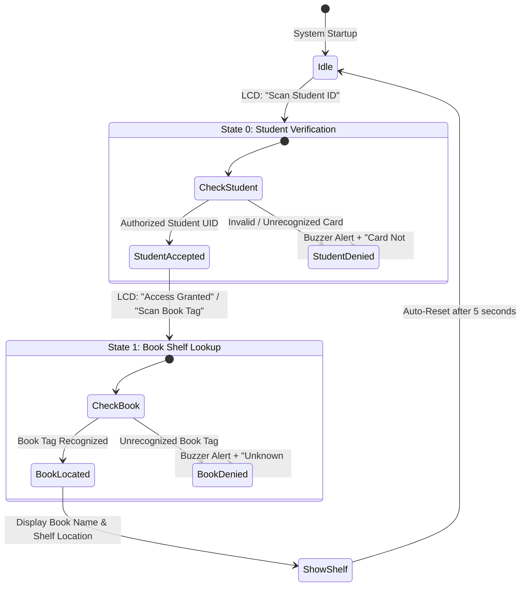

# ShelfSense - RFID-Powered Smart Library Guidance System

[](https://platformio.org/)
[](https://www.espressif.com/)
[](https://www.nxp.com/)
[](https://en.wikipedia.org/wiki/Liquid-crystal_display)

ShelfSense is an automated library navigation and check-in system built on the ESP32. It guides patrons to exact bookshelf locations for requested books using dual RFID card scanning (student verification followed by book catalog identification) alongside an interactive 16x2 I2C LCD screen, audio alerts, and LED indicators.

---

## Operational Workflow



---

## Features

- **Sequential Two-Factor Verification State Machine**:
  - **State 0 (Patron Authentication)**: Requires scanning an authorized student identification card before unlocking catalog queries.
  - **State 1 (Book Localization)**: Scans book RFID tags and cross-references catalog memory to determine the correct bookshelf number.
- **Local Visual Feedback**: 16x2 LCD with I2C backpack dynamically presents user prompts, patron status, book titles, and designated shelf locations.
- **Audio-Visual Alerting**:
  - Active buzzer (GPIO 27) issues acoustic confirmation on success and warning beeps on access denial.
  - High-brightness red status LED (GPIO 26) signals invalid card presentations.
- **Safe Hardware Pinout**: Conforms strictly to ESP32 GPIO allocation guidelines, avoiding strapping and internal SPI flash pins (GPIO 6-11).

---

## Hardware & Pinout Guide

### 1. RC522 RFID Reader (SPI Interface - VSPI)

> [!CAUTION]
> **CRITICAL POWER WARNING**: Supply **3.3V ONLY** to the RC522 RFID reader module. Connecting to 5V will permanently damage the RC522 chip.

| RC522 Pin | ESP32 GPIO | Pin Type | Notes |
| :--- | :--- | :--- | :--- |
| **VCC** | `3.3V` | Power (Fixed) | 3.3V power rail ONLY |
| **RST** | `GPIO 4` | Configurable GPIO | Reset pin (`RST_PIN`) |
| **GND** | `GND` | Ground (Fixed) | Common system ground |
| **IRQ** | *NC* | Not Connected | Unused |
| **MISO** | `GPIO 19` | Hardware SPI | VSPI MISO |
| **MOSI** | `GPIO 23` | Hardware SPI | VSPI MOSI |
| **SCK** | `GPIO 18` | Hardware SPI | VSPI Clock |
| **SDA (SS)** | `GPIO 5` | Hardware SPI | Slave Select (`SS_PIN`) |

### 2. 16x2 Character LCD with I2C Backpack

| LCD Backpack Pin | ESP32 GPIO | Pin Type | Notes |
| :--- | :--- | :--- | :--- |
| **VCC** | `5V / VIN` | Power | 5V required for proper backlight & contrast |
| **GND** | `GND` | Ground | Common ground |
| **SDA** | `GPIO 21` | Hardware I2C | Wire SDA |
| **SCL** | `GPIO 22` | Hardware I2C | Wire SCL |

> [!TIP]
> The default I2C address is usually `0x27` (or `0x3F`). Adjust the blue potentiometer on the back of the I2C module to calibrate display contrast.

### 3. Status Indicators (Buzzer & LED)

| Component | Component Terminal | ESP32 GPIO | Notes |
| :--- | :--- | :--- | :--- |
| **Buzzer** | Anode (+) | `GPIO 27` | Active Buzzer (`BUZZER_PIN`) |
| | Cathode (-) | `GND` | Common ground |
| **Red LED** | Anode (+) | `GPIO 26` | Status LED via 220Ω-330Ω resistor |
| | Cathode (-) | `GND` | Common ground |

---

## Software Dependencies & Configuration

From [`platformio.ini`](platformio.ini):

```ini
[env:esp32dev]
platform = espressif32
board = esp32dev
framework = arduino
monitor_speed = 115200
lib_deps = 
    marcoschwartz/LiquidCrystal_I2C@^1.1.4
    miguelbalboa/MFRC522@^1.4.12
```

### Customizing Catalog & Student UIDs
Modify database arrays in [`src/main.cpp`](src/main.cpp):

```cpp
// Registered Student RFID UIDs
String registeredStudents[] = {
  "37E09604"
};

// Registered Book RFID UIDs & Shelf Mappings
String registeredBooks[] = {
  "F10F7E05", // Book 1 -> Shelf 2
  "8DC0FA6B"  // Book 2 -> Shelf 4
};
int bookShelfMap[] = {2, 4};
```

---

## Build & Upload

```bash
# Compile firmware
pio run

# Flash to ESP32
pio run --target upload

# View real-time RFID scan serial logs
pio device monitor -b 115200
```

---

## Project Structure

```
ShelfSense/
├── src/
│   └── main.cpp         # Complete system logic, SPI RFID polling & LCD display routines
└── platformio.ini       # PlatformIO project configuration & library imports
```

---

## License

This project is licensed under the MIT License.
