# ShelfSense - RFID-Powered Smart Library Guidance System

[](https://platformio.org/)
[](https://www.espressif.com/)
[](https://www.arduino.cc/)
[](https://www.nxp.com/)
[](https://en.wikipedia.org/wiki/Liquid-crystal_display)
[](LICENSE)

**ShelfSense** is an intelligent, automated physical library guidance kiosk built on the ESP32. Designed for institutions and modern libraries (featuring welcome branding for **ABPS Nandyal**), it streamlines book lookup and return navigation using a two-factor RFID workflow: patrons authenticate with their student ID card, then scan any cataloged book tag to receive instant visual, acoustic, and animated shelf/rack guidance.

---

## Table of Contents

- [System Architecture & Workflow](#system-architecture--workflow)
- [Key Features](#key-features)
- [Hardware & Pinout Reference](#hardware--pinout-reference)
  - [1. RC522 RFID Reader (SPI / VSPI)](#1-rc522-rfid-reader-spi--vspi)
  - [2. 16x2 Character LCD (I2C Backpack)](#2-16x2-character-lcd-i2c-backpack)
  - [3. Status Indicators (Buzzer & Dual LEDs)](#3-status-indicators-buzzer--dual-leds)
  - [ESP32 Hardware Safety Guidelines](#esp32-hardware-safety-guidelines)
- [Operational Behavior & Guidance Choreography](#operational-behavior--guidance-choreography)
- [Software Configuration & Database Management](#software-configuration--database-management)
  - [Data Structures](#data-structures)
  - [Adding Students and Books](#adding-students-and-books)
  - [Discovering New Card UIDs](#discovering-new-card-uids)
- [Build, Flash & Monitor](#build-flash--monitor)
- [Serial Monitor Diagnostic Reference](#serial-monitor-diagnostic-reference)
- [Troubleshooting](#troubleshooting)
- [Project Structure](#project-structure)
- [License](#license)

---

## System Architecture & Workflow

ShelfSense runs a deterministic Finite State Machine (FSM) with intelligent cross-tag lookup, session persistence, and multi-tier feedback:

```mermaid
stateDiagram-v2
    [*] --> BootDiagnostics: Power ON / Reset
    BootDiagnostics --> WaitingForStudent: Splash (1.8s) -> Steady LCD: "Please Tap Your Student ID Card"

    state "State 0: WAITING_FOR_STUDENT" as WaitingForStudent {
        [*] --> DetectTag0: Card Presented
        DetectTag0 --> AuthSuccess: Valid Student UID
        DetectTag0 --> BookEarlyWarn: Scanned Book Tag Early
        DetectTag0 --> UnrecognizedAlarm0: Unregistered Tag
    }

    BookEarlyWarn --> WaitingForStudent: LCD: "Please Tap Your / Student ID First" (2 Warning Beeps + Red LED)
    UnrecognizedAlarm0 --> WaitingForStudent: LCD: "Unrecognized ID / Access Denied!" (2s Rapid Alarm + Red Strobe)

    AuthSuccess --> WaitingForBook: Beep + Green Pulse | LCD: "Hi <Name>" (Smooth Scroll) / "Tap Book Tag..."

    state "State 1: WAITING_FOR_BOOK" as WaitingForBook {
        [*] --> DetectTag1: Card Presented
        DetectTag1 --> BookFound: Valid Book Tag
        DetectTag1 --> StudentAgainWarn: Scanned Student Card Again
        DetectTag1 --> UnrecognizedAlarm1: Unregistered Tag
    }

    StudentAgainWarn --> WaitingForBook: LCD: "Please Tap Book / Tag (Not ID)" (Session Maintained)
    UnrecognizedAlarm1 --> WaitingForBook: LCD: "Unrecognized ID / Unknown Book Tag" (2s Alarm, Session Maintained)

    BookFound --> AnimatedGuidance: Beep + Green Pulse

    state "Animated Shelf Guidance & Return Sequence" as AnimatedGuidance {
        [*] --> TitleScroll: Adaptive Scroll Title (Line 1) + Green LED Rhythm
        TitleScroll --> RevealShelf: 4 chars before end: Reveal "Shelf:X Rack:Y" (Line 2) + Audio Chime
        RevealShelf --> HoldPhase1: Hold view 4s with Solid Green LED ON
        HoldPhase1 --> HoldPhase2: Move Shelf & Rack to Line 1; Line 2 scrolls "Please place it in given shelf" (4s)
        HoldPhase2 --> WarningPhase: LCD: "Session Ending.." + 3 Warning Beeps & Green LED Flashes (3s)
        WarningPhase --> [*]: Green LED OFF
    }

    AnimatedGuidance --> WaitingForStudent: Auto-Reset to Standby
```



---

## Key Features

- **Sequential Two-Tier State Machine**:
  - **Patron Authentication (`WAITING_FOR_STUDENT`)**: Validates student identity against registered credentials. Displays a brief reset splash (`"ShelfSense Ready / Smart Library"` for 1.8s) before settling into steady standby (`"Please Tap Your / Student ID Card"`), with personalized greetings and smooth scrolling for long names.
  - **Book Localization (`WAITING_FOR_BOOK`)**: Maps book tags to designated **Shelf** and **Rack** coordinates.
- **Cross-Tag Type Resolution & Session Memory**:
  - Scanning a book tag before student login prompts: `"Please Tap Your Student ID First"`.
  - Scanning a student ID while already in book-scan mode prompts: `"Please Tap Book Tag (Not ID)"` without ending the active student session.
  - Unrecognized tags trigger a **2-second emergency alarm** (rapid 100ms pulsing audio-visual strobe), while preserving the authenticated session during book lookups for frictionless retry.
- **Dynamic Animated Guidance Choreography**:
  - **Adaptive Title Scrolling**: Automatically chooses 280ms/char for titles $\le 30$ characters and accelerates to 180ms/char for longer titles, accompanied by rhythmic Green LED blinking.
  - **Pre-Reveal Cue**: Exactly 4 characters before title scrolling concludes, Line 2 reveals `Shelf:X  Rack:Y` with an immediate single audio chime.
  - **Two-Phase 8-Second Location Hold**:
    - **Phase 1 (0–4s)**: Displays Title + Shelf/Rack with solid Green LED illumination.
    - **Phase 2 (4–8s)**: Promotes Shelf/Rack info to Line 1, while Line 2 continuously scrolls `"Please place it in given shelf"` at 280ms per character.
  - **Session-Ending Countdown**: Issues 3 medium beeps paired with simultaneous Green LED flashes over 3 seconds with `"Session Ending.."`, then turns off all LEDs and resets to standby.
- **Comprehensive Boot Diagnostics & Self-Healing**:
  - Scans I2C bus at startup (`0x27`, `0x3F`, or dynamic scan from `0x01` to `0x7F`) to ensure display connection.
  - Displays branded welcome splash screens (`"ABPS Nandyal - Welcome!"` $\rightarrow$ `"ShelfSense - Smart Library"`).
  - Queries RC522 SPI version registers (identifies v2.0 `0x92`, v1.0 `0x91`, FM17522 clone `0x88`, or reports SPI communication faults).
  - Performs an automated power-on indicator test (Green LED, Red LED, and Buzzer).

---

## Hardware & Pinout Reference

### 1. RC522 RFID Reader (SPI / VSPI)

> [!CAUTION]
> **CRITICAL VOLTAGE REQUIREMENT**: Power the RC522 module with **3.3V ONLY**. Connecting VCC to the 5V rail will permanently damage the RC522 RFID chip.

| RC522 Pin | ESP32 GPIO | Pin Type | Description / Notes |
| :--- | :--- | :--- | :--- |
| **VCC** | `3.3V` | Power (Fixed) | Must connect to 3.3V power rail ONLY |
| **RST** | `GPIO 4` | Digital Output | RC522 Reset pin (`RST_PIN`) |
| **GND** | `GND` | Ground (Fixed) | Common system ground |
| **IRQ** | *NC* | Not Connected | Unused for polled SPI operation |
| **MISO** | `GPIO 19` | Hardware SPI | Default VSPI Master-In-Slave-Out |
| **MOSI** | `GPIO 23` | Hardware SPI | Default VSPI Master-Out-Slave-In |
| **SCK** | `GPIO 18` | Hardware SPI | Default VSPI Serial Clock |
| **SDA (SS)**| `GPIO 5` | Digital Output | Hardware SPI Slave Select (`SS_PIN`) |

### 2. 16x2 Character LCD (I2C Backpack)

| LCD Backpack Pin | ESP32 GPIO | Pin Type | Notes |
| :--- | :--- | :--- | :--- |
| **VCC** | `5V / VIN` | Power (Fixed) | 5V required for backlight brightness and contrast |
| **GND** | `GND` | Ground (Fixed) | Common system ground |
| **SDA** | `GPIO 21` | Hardware I2C | Wire Data line |
| **SCL** | `GPIO 22` | Hardware I2C | Wire Clock line |

> [!TIP]
> The default PCF8574 I2C address is usually `0x27` (or `0x3F`). ShelfSense includes an automatic bus scanner at boot. Adjust the blue potentiometer on the back of the backpack module to calibrate display text contrast.

### 3. Status Indicators (Buzzer & Dual LEDs)

| Component | Terminal | ESP32 GPIO | Notes |
| :--- | :--- | :--- | :--- |
| **Active Buzzer** | Anode (+) | `GPIO 27` | Configurable (`BUZZER_PIN`) |
| | Cathode (-) | `GND` | Common ground |
| **Red Status LED** | Anode (+) [Long leg] | `GPIO 26` | Configurable (`RED_LED_PIN`), connect via 220Ω–330Ω resistor |
| | Cathode (-) [Short leg] | `GND` | Common ground |
| **Green Status LED** | Anode (+) [Long leg] | `GPIO 25` | Configurable (`GREEN_LED_PIN`), connect via 220Ω–330Ω resistor |
| | Cathode (-) [Short leg] | `GND` | Common ground |

### ESP32 Hardware Safety Guidelines

> [!WARNING]
> - **DO NOT USE GPIO 6 through 11**: These pins are connected directly to the ESP32's integrated SPI flash memory. Using them will crash the microcontroller.
> - Ensure all components share a **common ground** (`GND`).

---

## Operational Behavior & Guidance Choreography

| Event / Phase | Visual Display (16x2 LCD) | Audio Feedback (Buzzer) | Visual LED Status | Duration / Timing |
| :--- | :--- | :--- | :--- | :--- |
| **Reset Transition** | `ShelfSense Ready`<br>`Smart Library` | Silent | All LEDs OFF | 1.8 seconds splash |
| **Standby / Ready** | `Please Tap Your`<br>`Student ID Card` | Silent | All LEDs OFF | Continuous steady standby |
| **Student Authenticated** | `Hi <Student Name>` (scrolling)<br>`Tap Book Tag...` | 1 short beep (100ms) | Green LED pulse | 2.5s |
| **Book Tag Identified** | Line 1: Book Title (adaptive scroll)<br>Line 2: Blank initially | 1 confirmation beep (150ms) | Green LED blinks (2 ON, 1 OFF) | Dynamic title length |
| **Shelf/Rack Pre-Reveal** | Line 1: Continuing title scroll<br>Line 2: `Shelf:X  Rack:Y` | 1 single chime (100ms) | Green LED continues | Exactly 4 chars before end |
| **Guidance Hold (Phase 1)** | Line 1: Book Title (first 16 chars)<br>Line 2: `Shelf:X  Rack:Y` | Silent | Green LED solid ON | 4.0 seconds |
| **Placement Prompt (Phase 2)**| Line 1: `Shelf:X  Rack:Y`<br>Line 2: `Please place it in given shelf` | Silent | Green LED solid ON | 4.0 seconds (280ms scroll) |
| **Session Ending Warning** | Line 1: `Shelf:X  Rack:Y`<br>Line 2: `Session Ending..` | 3 medium beeps (500ms ON / 500ms OFF) | Green LED flashes synchronously | 3.0 seconds |
| **Out-of-Order Scan** | E.g. `Please Tap Your`<br>`Student ID First` | 2 warning pulses (180ms ON / 120ms OFF) | Red LED flashes synchronously | 1.5s pause |
| **Emergency Alarm** | `Unrecognized ID`<br>`Access Denied!` / `Unknown Book Tag` | Rapid 10-pulse siren (100ms ON / 100ms OFF) | Red LED rapid strobe | 2.0s alarm + 1.0s read time |

---

## Software Configuration & Database Management

### Data Structures

Records are defined using strongly-typed structs in [`src/main.cpp`](src/main.cpp):

```cpp
// Structure modeling student credentials
struct Student {
  String name;     // Student's full name (e.g. "Pavan")
  String uid;      // RFID tag UID in uppercase HEX without spaces (e.g. "37E09604")
};

// Structure modeling book catalog entries with spatial coordinates
struct Book {
  String title;    // Book title (e.g. "Algorithms")
  String uid;      // RFID tag UID in uppercase HEX without spaces (e.g. "F10F7E05")
  int shelf;       // Assigned shelf number
  int rack;        // Assigned rack number
};
```

### Adding Students and Books

Modify the database arrays directly in [`src/main.cpp`](src/main.cpp):

```cpp
// List of authorized students
const Student registeredStudents[] = {
  { "Pavan", "37E09604" },
  { "Donkey DVS", "A97AF8B2" }
  // Add new students: { "Name", "UID" },
};

// Database of registered books with shelf and rack assignments
const Book registeredBooks[] = {
  { "Geronimo Stilton - Journey to the Center of the Earth", "F10F7E05", 2, 1 }, // Shelf 2, Rack 1
  { "Harry Potter", "8DC0FA6B", 4, 3 }                                           // Shelf 4, Rack 3
  // Add new books: { "Title", "UID", shelf, rack },
};
```

### Discovering New Card UIDs

To register a new card or book tag:
1. Open the PlatformIO Serial Monitor at **115200 baud**.
2. Tap the physical RFID tag on the RC522 antenna.
3. Observe the output:
   ```text
   ---------------------------------------------------
   [RFID]    Card Detected! UID: 37E09604 | Size: 4 bytes | PICC Type: MIFARE 1KB
   ```
4. Copy the HEX string into `registeredStudents[]` or `registeredBooks[]` in [`src/main.cpp`](src/main.cpp) and re-flash the firmware.

---

## Build, Flash & Monitor

ShelfSense is built with [PlatformIO](https://platformio.org/).

### Prerequisites

- [VS Code](https://code.visualstudio.com/) with the [PlatformIO IDE extension](https://marketplace.visualstudio.com/items?itemName=platformio.platformio-ide), or the [PlatformIO Core (CLI)](https://docs.platformio.org/page/core.html).
- ESP32 connected via USB.

### PlatformIO Configuration (`platformio.ini`)

```ini
[env:esp32dev]
platform = espressif32
board = esp32dev
framework = arduino
monitor_speed = 115200
lib_deps = 
    marcoschwartz/LiquidCrystal_I2C@^1.1.4
    miguelbalboa/MFRC522@^1.4.12
```

### CLI Commands

```bash
# Compile project
pio run

# Upload firmware to ESP32
pio run --target upload

# Open Serial Monitor at 115200 baud
pio device monitor -b 115200

# Perform clean build and upload
pio run -t clean && pio run -t upload
```

---

## Serial Monitor Diagnostic Reference

ShelfSense produces categorized, human-readable serial logs for observability and debugging:

| Tag | Meaning | Example Output |
| :--- | :--- | :--- |
| `[BOOT]` | Startup diagnostics, heap memory, and peripheral discovery | `[BOOT] RC522 Firmware Version Register: 0x92` |
| `[RFID]` | Low-level tag detection, UID extraction, and PICC classification | `[RFID] Card Detected! UID: F10F7E05 \| Size: 4 bytes` |
| `[AUTH]` | Student identification and credential checks | `[AUTH] Match found! Student: "Pavan" at index [0]` |
| `[LOOKUP]` | Book catalog searches and coordinate retrieval | `[LOOKUP] Match found! Book: "..." -> Shelf 2, Rack 1` |
| `[STATE]` | State machine transitions | `[STATE] Transition: WAITING_FOR_STUDENT -> WAITING_FOR_BOOK` |
| `[FEEDBACK]` | Buzzer, Red LED, and Green LED hardware invocations | `[FEEDBACK] SUCCESS -> Green LED + Buzzer (1 beep @ 150 ms)` |
| `[LCD]` | Display screen updates and scroll frame activity | `[LCD] Line 2 revealed (4 chars before end): "Shelf:2 Rack:1"` |
| `[TIMER]` | Second-by-second countdown logs for guidance holds | `[TIMER] Hold elapsed: 4s / 8s [View: Title + Shelf & Rack]` |
| `[WARN]` | Non-fatal warnings (e.g. wrong scan order) | `[WARN] Book tag scanned at Step 1 instead of Student ID!` |
| `[ERROR]` | Serious faults (unrecognized tag emergency, hardware failure) | `[ERROR] EMERGENCY ALARM TRIGGERED: Unrecognized tag UID: A1B2C3D4` |

---

## Troubleshooting

### 1. RC522 RFID Reader Communication Failure (`0x00` or `0xFF`)
- **Symptoms**: Serial Monitor outputs `RC522 RFID READER COMMUNICATION FAILED!` and version is `0x00` or `0xFF`.
- **Resolution**:
  - Verify VCC is on **3.3V** (never 5V).
  - Inspect SPI connections: `SCK` $\rightarrow$ GPIO 18, `MISO` $\rightarrow$ GPIO 19, `MOSI` $\rightarrow$ GPIO 23, `SS/SDA` $\rightarrow$ GPIO 5, `RST` $\rightarrow$ GPIO 4.
  - Verify soldered header pins for dry solder joints or bridging between adjacent pins.

### 2. LCD Shows Blank Screen or Black Boxes
- **Symptoms**: Backlight turns on, but no characters appear or solid rectangles show.
- **Resolution**:
  - Rotate the blue contrast potentiometer on the back of the I2C backpack with a small screwdriver.
  - Check whether the backpack is receiving a full **5V** supply (ESP32 `VIN` pin when powered via USB).
  - Check Serial Monitor `[BOOT]` output: if the device was found at an address other than `0x27`, ShelfSense will automatically attempt discovery.

### 3. False Triggering or RFID Bounce
- **Symptoms**: Multiple rapid detections of the same tag.
- **Resolution**:
  - ShelfSense invokes `mfrc522.PICC_HaltA()` after reading and filters out unreadable RF noise frames. Ensure the tag is swept smoothly across the antenna rather than held continuously on it.

---

## Project Structure

```text
ShelfSense/
├── include/                 # Project headers
├── lib/                     # Custom private libraries (if any)
├── src/
│   └── main.cpp             # Complete FSM logic, diagnostics, display animation & RFID handling
├── test/                    # Unit testing suites
├── platformio.ini           # PlatformIO environment, target board & dependencies
└── README.md                # System documentation
```

---

## License

This project is licensed under the [MIT License](LICENSE). Feel free to adapt and expand it for your library automation needs.